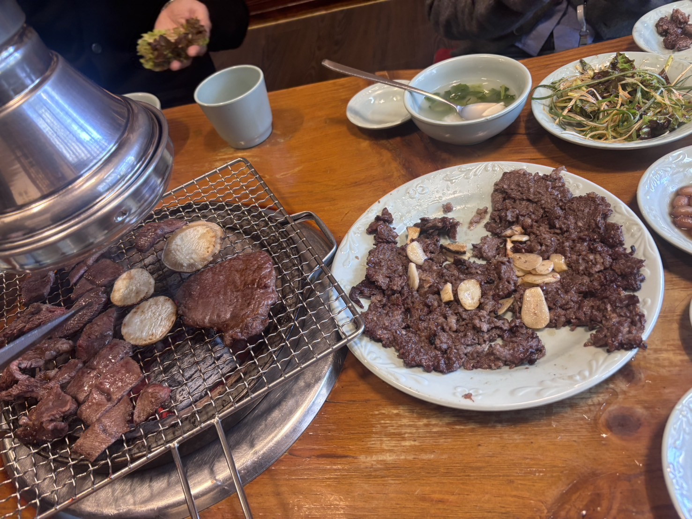
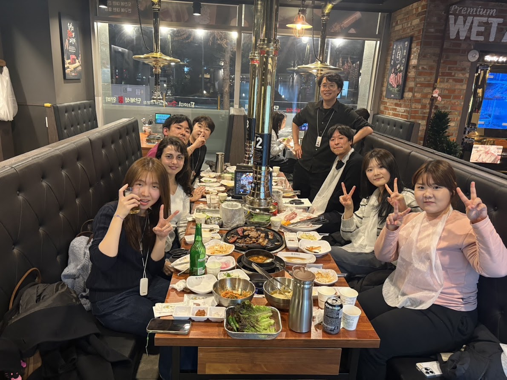
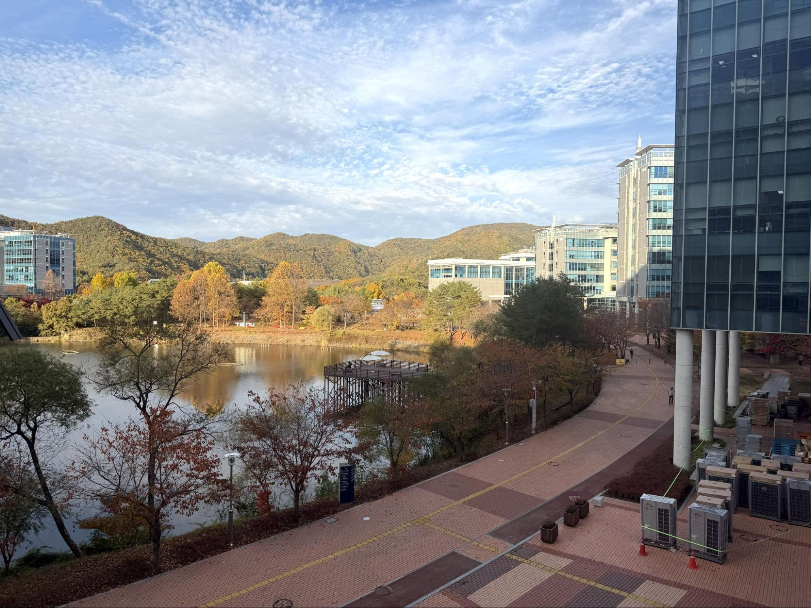
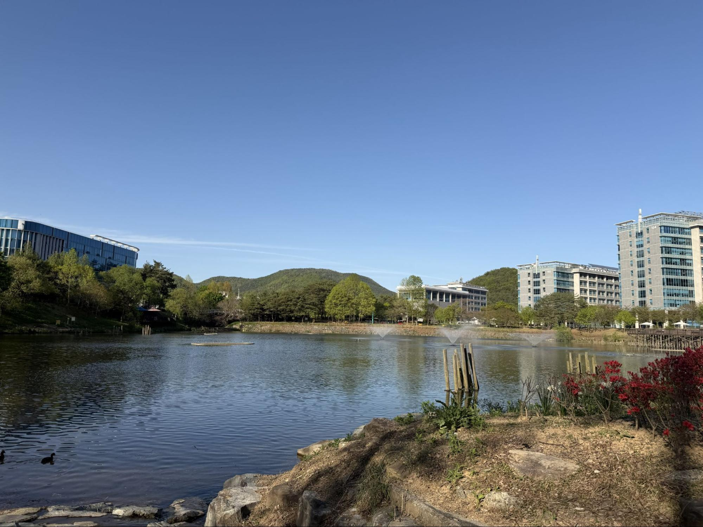

Show Notes:
お便り募集中。特典音源送付希望の方は[フォーム](https://docs.google.com/forms/d/1jK0VRj9MQI-J9LcQpF7JLNHqydGpy78qgjvltb9ll3c/viewform?edit_requested=true#response=ACYDBNggxH4mQQPbJG-8zx6wbL4X_ZXb2NYtP9-X2GapGMMtngWpTuxfzspnpgKO6mqw3IA)から、完全匿名希望の方は、[マシュマロ](https://marshmallow-qa.com/neuroradio_?t=YMGNtO&utm_medium=url_text&utm_source=promotion)からどうぞ。
長濱 健一郎さん([Lab HP](https://sites.google.com/view/nagahama-neuro-lab-unist), [X](https://x.com/k_hammer_1001), [Bluesky](https://bsky.app/profile/k-hammer.bsky.social))
長濱さん過去NR出演回: [#51](https://neuroradio.tokyo/2023/01/17/51-a-precise-tagging-of-active-neurons/), [#96](https://neuroradio.tokyo/2025/09/16/96-crash-landing-on-u/)
[蔚山科学技術院(UNIST)](https://www.unist.ac.kr/)
[つるとんたん](https://www.tsurutontan.co.jp/)
[福岡のうどん](https://youtube.com/shorts/lsPaBnYG22I?si=SOc4UUL97k_UVfW3)
[森下 博文さん](https://labs.icahn.mssm.edu/morishitalab) (NR出演回: [#112](https://neuroradio.tokyo/2026/09/21/112-Critical-Period/))
[Hyungbae Kwon](https://sites.google.com/view/kwon-lab)
[Jung Ho Hyun](https://scholar.dgist.ac.kr/researcher/125c463c-2791-458d-a8be-a81ee2629916)（Kwon LabでのJung Hoとの仕事: [ST-Cal-Light](https://www.nature.com/articles/s41467-022-35406-y)）
[狩野 方伸先生](https://www3.med.teikyo-u.ac.jp/profile/ja.3865415e46b20070.html)
[Jae-Ick Kim](https://jikimlab.imweb.me/) (最近のお仕事：[1](https://www.nature.com/articles/s41467-026-71426-8), [2](https://www.nature.com/articles/s41467-026-69129-1))
[Bong-Kiun Kaang](https://en.wikipedia.org/wiki/Kaang_Bong-kiun)
[IBS: Institute for Basic Science](https://www.ibs.re.kr/eng.do)
[Jun Ding](https://med.stanford.edu/dinglab.html) ([Jae-Ickの仕事](https://www.science.org/doi/full/10.1126/science.aac4690))
[Bernardo Sabatini](https://sabatini.hms.harvard.edu/)
[Karl Deisseroth](https://web.stanford.edu/group/dlab/)
[John O'Keefe](<https://en.wikipedia.org/wiki/John_O%27Keefe_(neuroscientist)>)
[坂口 昌徳先生](https://www.med.kobe-u.ac.jp/GRADN/BMS/setsumeikai/2026jizensiryou/2026neurophysiology_sakaguchi.pdf)
[北村 貴司さん](https://profiles.utsouthwestern.edu/profile/168331/takashi-kitamura.html)
[Doyun Lee](https://doyunleelab.wordpress.com/)
[Albert Lee](https://www.albertleeneuro.org/) (たぶんDoyunがfirst postdocのようです、Doyunのお仕事：[1](https://www.science.org/doi/full/10.1126/science.1221489), [2](https://www.nature.com/articles/nprot.2014.190))
[Yong-Seok Lee](https://biomed.snu.ac.kr/en/research-faculty/faculty?mode=view&profidx=30)
[Alcino Silva](https://neurobio.ucla.edu/people/alcino-silva-phd)
[Sangkyu Lee](https://sites.google.com/view/sklee/) (Postdoc mentorは同じく元コラボレーターの[Won Do Heo](https://heolab.kaist.ac.kr/lab-2-en))
SynapShot論文: [Son, Nagahama et al., 2024](https://www.nature.com/articles/s41592-023-02122-4)
[KSBNS（Korean Society for Brain and Neural Sciences）](https://www.ksbns.org/)
[今井 猛先生](https://www.lab.med.kyushu-u.ac.jp/dn/)
[藤田 啓史さん](https://labs.utsouthwestern.edu/fujita-lab)
[Jun Huh](https://huhlab.med.harvard.edu/)
[Gloria Choi](https://picower.mit.edu/gloria-choi)
[Jennifer Raymond](https://raymondlab.stanford.edu/)
[柳沢 正史先生](https://wpi-iiis.tsukuba.ac.jp/japanese/research/member/detail/masashiyanagisawa/)
[KBRI（Korea Brain Research Institute）](https://www.kbri.re.kr/)
小坂田 拓哉さん([Researchmap](https://researchmap.jp/takuyaosakada), [X](https://x.com/TakuyaOsakada))（NR出演回: [#104](https://neuroradio.tokyo/2026/05/12/104-empire-social-state-of-mind/)）
岡澤さん回（[#115](https://neuroradio.tokyo/2026/10/19/115-Curving-Decisions-in-Shanghai/)）
[Weee!](https://www.sayweee.com/en)
[Regalo](https://tabelog.com/en/tokyo/A1318/A131810/13057629/)
[Sio](https://sio.tokyo/restaurants/)（結婚の公式報道はないようです byながはま）※sio & sio2ともにおすすめです byながはま
[彦陽（オニャン）プルコギ](https://english.visitkorea.or.kr/svc/contents/contentsView.do?vcontsId=191205)（写真、小坂田さん撮影）
NRF (National Research Foundation in Korea): 日本のJSPS的なpublic fund source
※個人グラントとチームグラントに分かれている。NRFグラントに関しては、1研究者辺り3책5공（3責5共、研究責任者として最大3件（うち個人グラントは1件のみ）、グラント全体で最大5件 ）という縛りがある。
[うーひゅん (Wuhyun Koh)](https://glia.ibs.re.kr/html/glia_en/people/people_0211.html)
[Samsungのグラント](https://www.samsungstf.org/ssrfPr/researcher/science.do)
※その他のprivate foundationとして[POSCO](https://www.postf.org/en/asia/purpose)や[Suh Kyungbae](https://www.suhf.org/program/business.do)が有名
[韓国のビザ](http://haniseoul.com/ja/blogs/south-korea-visa-types-comprehensive-guide-hub)：[E-1（教授）](https://www.haniseoul.com/ja/blogs/south-korea-e1-professor-visa-guide)、[E-3（研究）](https://www.haniseoul.com/ja/blogs/south-korea-e3-research-visa-guide)は基本的に大学経由で申請するので、申請者自身の手間はあまりかからない。
M.P.H.: [Master of Public Health](https://publichealth.jhu.edu/academics/mph) (公衆衛生学修士)
外国人facultyの割合：約11%（[大学公式](https://adm-u.unist.ac.kr/admission/introduction/unist-overview.do)）
[HST](https://hst.unist.ac.kr/hst/index.do)：Graduate School of Health Science and Technology（韓国語名は의과학대학원（日本語で医科学大学院））。
[BME](https://bme.unist.ac.kr/eng/)：Department of Biomedical Engineering（生体医工学）
学生は随時募集中：年に3回入試があり、入学は9月または翌年3月になります（[入試情報](https://admg-intl.unist.ac.kr/admg-eng/index.do)）。修士の学生さんから給与ちゃんと出せます。zoomでちょっと話がききたい、くらいの感じからウェルカムなので、気軽に連絡ください！byながはま

<figure>
  
  <figcaption>彦陽（オニャン）プルコギ（小坂田さん撮影）</figcaption>
</figure>
<figure>
  
  <figcaption>うーひゅんとゆかいな仲間たちと肉＠Daejeon</figcaption>
</figure>
<figure>
  
  <figcaption>Officeの窓からの景色</figcaption>
</figure>
<figure>
  
  <figcaption>窓からみえる池（キャンパス内）</figcaption>
</figure>

Editorial Notes:
僕もマシッソヨしたい(萩)
HマートのHは韓を意味するのかと思いきや「ひとかかえ（の食料品）」を意味する「ハナルム」から来ているらしい(脇)
異国の地で仲間を集めながら、ラボの立ち上げに奔走されている様子をライブ感たっぷりにシェアしていただき、ありがとうございます。オニャンプルコギたべたい。(藤)
聞き返すとほぼ研究の話をしていない笑。日常生活ではオニャンプルコギ食べない（≒ ゲストが来ないと食べれない）ので、どんどん遊びに来てください。修士・博士の学生は随時募集しているので、興味のある方からのご連絡お待ちしてます！(長濱)
韓国にはUSにあるけど日本にないFIVE GUYSやAuntie Anne’sのお店があって最高でした（なお、食べてはいない）。チュリンムン タッスムニダ（今回の訪韓で唯一覚えたフレーズ）(小坂田)
